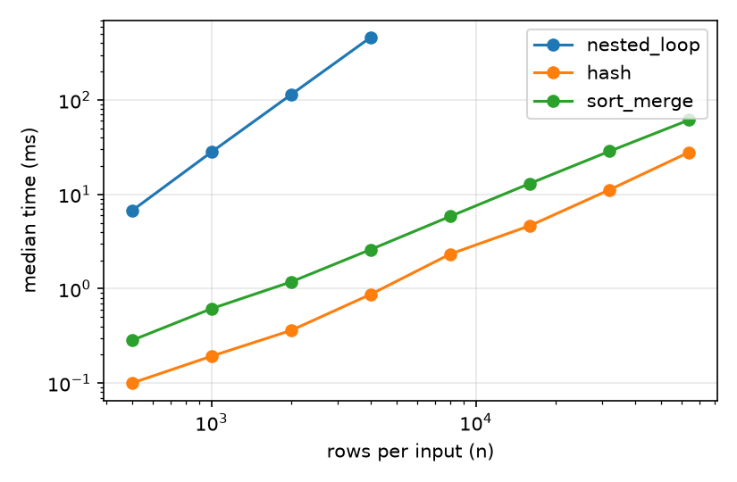

# Equi-Join Algorithms in Pure Python: A Small Reproducible Benchmark of Nested-Loop, Hash, and Sort-Merge Joins Under Scale, Key Skew, and Pre-Sorted Input

**Avi Sharoni**, Independent (asharoni@gmail.com). October 2026

> **Self-published technical note. Not peer reviewed.** All numbers come from one run of `code/experiment.py` on one machine, and the raw output is in `results.json`. Treat them as illustrative, not definitive.

## Abstract

I implemented three textbook equi-join algorithms in pure Python (nested-loop, hash, and sort-merge) and timed them on synthetic two-column relations. Each configuration reports the median of 3 to 5 repetitions. On uniform keys, the hash join was the fastest at every size tested. At n = 64,000 rows per side it was about 2.2x faster than sort-merge (27.9 ms vs 61.5 ms). Nested-loop scaled quadratically, taking 461 ms already at n = 4,000. When I drew keys from a Zipf distribution, output size grew by more than 300x and swamped any algorithmic difference: at s ≥ 1.0 both algorithms spent roughly 0.8 to 3 s, mostly building result tuples, and sort-merge was slightly faster at s = 1.0. Pre-sorted input cut sort-merge time by about 23% (62.1 to 48.1 ms) but did not close the gap with hash. This is a small, honest replication of classic database-systems results at interpreter scale. It is not a new contribution.

## 1. Setup

- **Code:** `code/joins.py`, also in [avisharoni/algorithms-research-notebook](https://github.com/avisharoni/algorithms-research-notebook), with unit tests against nested-loop as an oracle.
- **Hash join:** builds a hash table on the smaller input and probes with the larger.
- **Sort-merge join:** sorts both inputs with Python's Timsort, then merges, emitting the cross product of equal-key runs.
- **Data:** relations R and S of n tuples `(key, id)`.
  - Scale test: keys uniform in [0, n).
  - Skew test: n = 20,000, 5,000 distinct keys, Zipf exponent s ∈ {0, 0.5, 1.0, 1.2}.
- **Timing:** `time.perf_counter`, median of 5 runs (3 for nested-loop and for the skew runs).
- **Environment:** CPython 3.13.5, x86_64 Linux cloud VM, 8 logical CPUs, single-threaded code.

## 2. Results

### 2.1 Scale (uniform keys)

| n | nested-loop (ms) | hash (ms) | sort-merge (ms) | output rows |
|---:|---:|---:|---:|---:|
| 500 | 6.70 | 0.10 | 0.28 | 504 |
| 1,000 | 28.07 | 0.19 | 0.61 | 1,004 |
| 2,000 | 113.99 | 0.36 | 1.18 | 1,962 |
| 4,000 | 460.97 | 0.87 | 2.60 | 4,002 |
| 8,000 | — | 2.33 | 5.84 | 7,897 |
| 16,000 | — | 4.65 | 13.04 | 16,002 |
| 32,000 | — | 11.18 | 28.61 | 32,061 |
| 64,000 | — | 27.93 | 61.45 | 63,716 |



Each doubling of n multiplied nested-loop time by about 4.0 to 4.2, consistent with O(n²). From 8k to 64k rows, hash time grew about 2.0 to 2.5x per doubling and sort-merge about 2.1 to 2.2x. That is slightly superlinear, as expected from O(n log n) sorting, and at the large sizes probably also from cache and memory effects that I did not isolate.

### 2.2 Key skew (n = 20,000, 5,000 keys)

| Zipf s | output rows | hash (ms) | sort-merge (ms) |
|---:|---:|---:|---:|
| 0.0 | 79,855 | 10.44 | 22.74 |
| 0.5 | 186,237 | 22.49 | 30.12 |
| 1.0 | 7,955,081 | 940.23 | 822.64 |
| 1.2 | 25,280,633 | 2,913.36 | 3,013.32 |

Under heavy skew the join output explodes, because hot keys produce large cross products. Runtime then tracks output size, not the join strategy. The algorithms' relative order flipped at s = 1.0 and the gap stayed within about 15%. With one run per configuration, I would not read much into the flip.

### 2.3 Pre-sorted input (n = 64,000)

| input | hash (ms) | sort-merge (ms) |
|---|---:|---:|
| random | 28.89 | 62.13 |
| pre-sorted | 25.84 | 48.06 |

Timsort exploits existing runs, so sort-merge gained about 23%. A real engine would skip the sort step entirely when the input is already sorted on the key, which I did not implement.

## 3. Threats to validity

- Results come from a single machine, a single run of the script, and a noisy shared VM.
- Pure Python inflates constant factors, especially tuple allocation, compared with C or vectorized engines. The absolute numbers say little about real DBMSs.
- I did not test memory limits or spilling (e.g. Grace hash join), and I did not use multiple threads.
- The data is synthetic. Real workloads differ.

## 4. Reproduce

```bash
pip install matplotlib
python code/experiment.py   # rewrites results.json and fig_scale.png
```

## References

1. Shapiro, L. D. (1986). Join processing in database systems with large main memories. *ACM Transactions on Database Systems*, 11(3), 239–264.
2. Graefe, G. (1993). Query evaluation techniques for large databases. *ACM Computing Surveys*, 25(2), 73–169.
